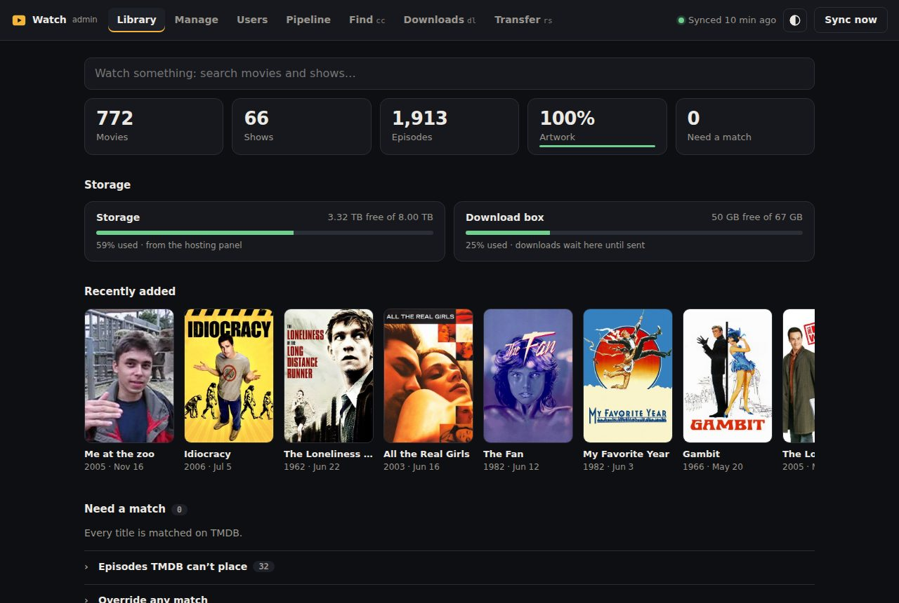
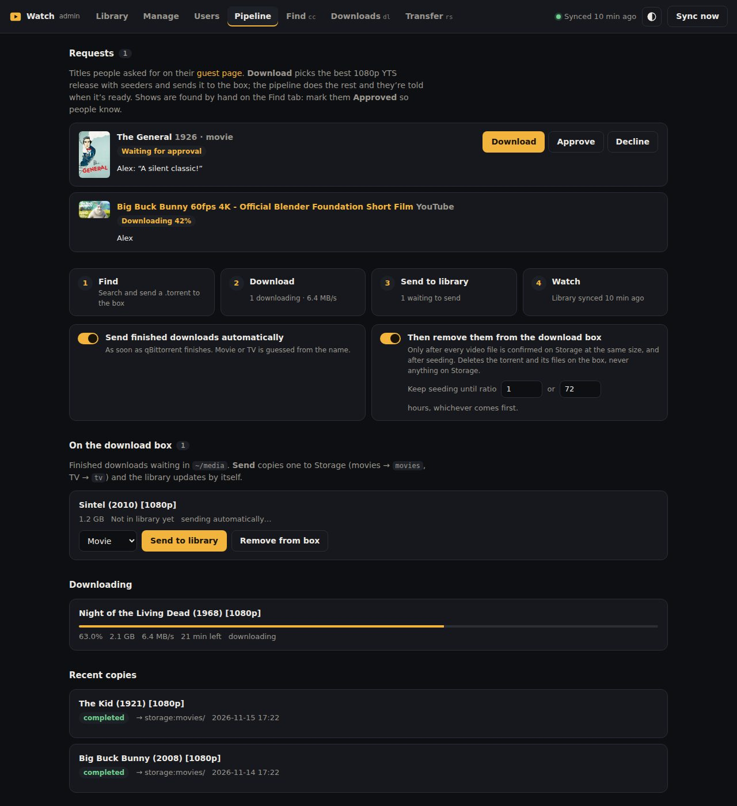
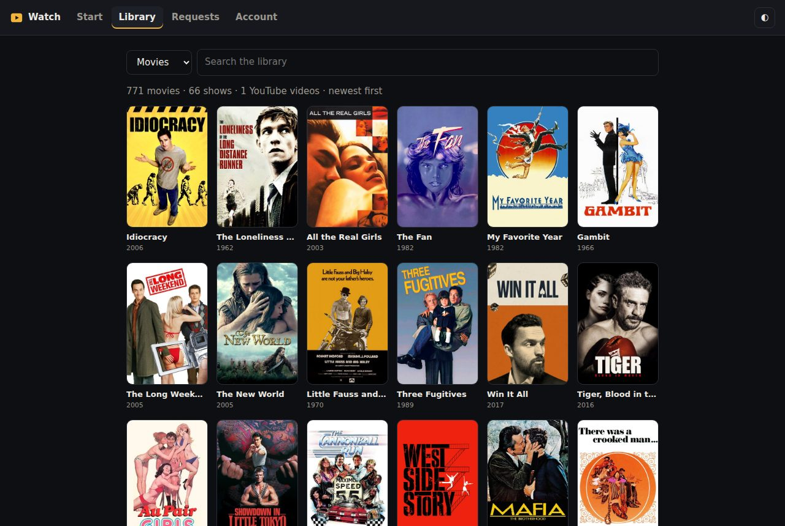
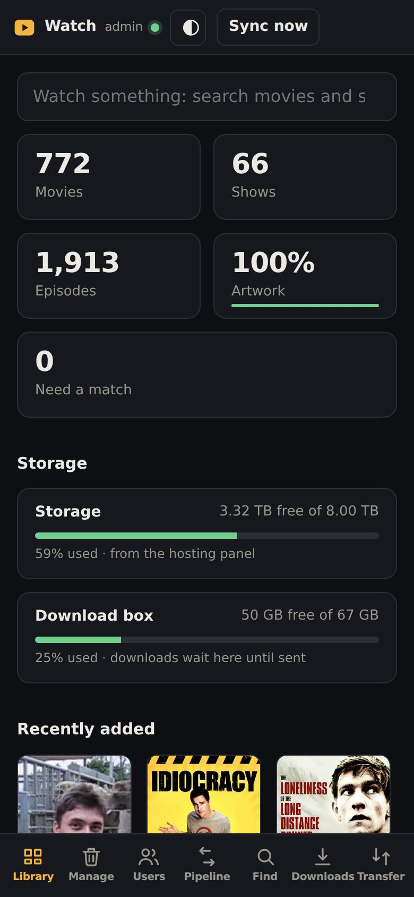
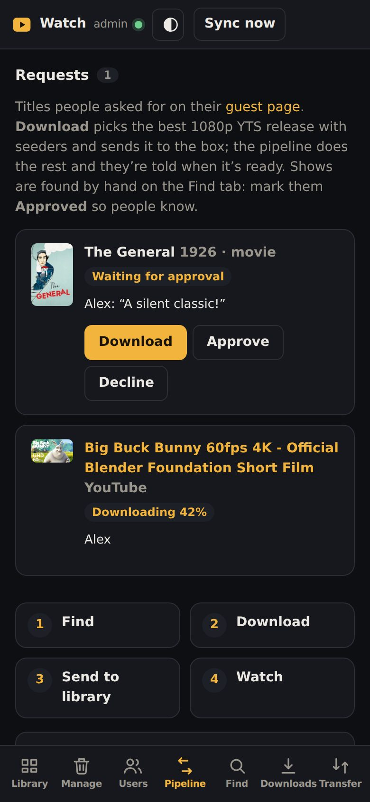

# watchbox



Your own movie and TV server, without running a media server. **watchbox** speaks the Jellyfin API from a Cloudflare
Worker, streams your video files straight from a storage host you already have (cheap shared hosting with PHP, or a
VPS), and gets its posters and metadata from TMDB. Use it with VidHub, the official Jellyfin apps (Android TV, iOS,
Android, Fire TV), Swiftfin, Findroid, Streamyfin and other Jellyfin clients.

## What you get

- **A Jellyfin server for your apps**: continue watching, next up, favorites, subtitles, several versions per title,
  Quick Connect, posters and metadata from TMDB, a library that updates itself every 15 minutes.
- **An admin page** to manage the library, delete into a restorable trash, and see storage at a glance.
- **Optional download box** (any small Linux or FreeBSD VPS): find and download titles, add YouTube videos and
  playlists, and copy everything to your storage automatically.
- **Invited guests** with their own logins, watch history and requests, **age limits** for kids,
  **browser playback** (converted on the fly when needed) and **share links** for one title.

|  |  |
|---|---|
| **Pipeline**: guests' requests, downloads in progress, copies to storage, YouTube | **Guest page**: invited people browse, watch in the browser and ask for titles |

## How it fits together

```
 Storage host (PHP + your files)                Cloudflare
 ├─ src/<folder>/<file>  ← byte ranges ───────── Worker ── Jellyfin API ── TV / phone apps
 ├─ list.php             ← every 15 min ───────   │  ├── /admin   (Access: you)        ┐
 └─ manage.php           ← delete / restore ───   │  ├── /me      (Access: guests)     ├─ browser player
                                                   │  └── /s/<id>  (public share link)  ┘
 TMDB                    ← match, art, ratings ───┤  D1: library, users, progress, requests
 Download box (optional, Caddy + HTTPS) ──────────┘  qBittorrent + VueTorrent, c-cli, rsync-web, watch-stream
   finished downloads and YouTube videos ──rsync──▶ storage host
```

<p align="center"> &nbsp; </p>
<p align="center"><sub>Works on phones too. <b><a href="docs/screenshots/">More screenshots →</a></b> (users and age limits, the browser player, light theme)</sub></p>

## What you need

- A domain on **Cloudflare**, the **Workers Paid** plan ($5/month: the library sync needs more CPU time than the
  free plan allows), and **Zero Trust** (the free plan) for the admin and guest logins.
- A **storage host** with your videos: shared hosting with PHP 8 and SSH (DirectAdmin and cPanel are supported,
  including [HostBRR storage plans](docs/storage-shared-hosting.md#hostbrr)), or a Debian/Ubuntu VPS.
- A free **TMDB** API read token.
- Optional: a **download box**, a small Debian, Ubuntu or FreeBSD VPS.

## Install (three parts, about 20 minutes)

### Getting watchbox onto each server

Either way works; use the same one on every server.

| | **Release bundle** (simplest) | **Git clone** |
|---|---|---|
| Get it | `curl -fLO https://github.com/jgbrwn/watchbox/releases/latest/download/watchbox-<version>.tar.gz` (see [Releases](../../releases)), then `tar xzf` it | `git clone https://github.com/jgbrwn/watchbox` |
| Storage installers | PHP files included | PHP files included |
| Download box programs (watch-stream, c-cli-web, rsync-web) | prebuilt for Linux and FreeBSD (amd64, arm64) and included | the installer downloads the same prebuilt programs from the latest release and checks their SHA-256 sums; or add `--build` to compile them on the box from your checkout (it fetches Go for the build and removes it afterwards) |
| Cloudflare setup (runs on your own computer) | not included: use a clone | `cd worker && npm install` |
| Upgrading | download the next bundle | `git pull` |

Storage and the Worker are plain PHP and JavaScript (nothing to compile). Besides its three programs, the box
installs qBittorrent, Caddy, FFmpeg and Node/Deno from the system's package manager, and VueTorrent and yt-dlp from
their official releases.

### The three parts

1. **Storage**
   - VPS: `sudo sh storage/install.sh --domain storage.example.com` → [docs/storage-vps.md](docs/storage-vps.md)
   - Shared hosting: `sh storage/install-shared.sh --web-dir … --media-dir … --domain …` →
     [docs/storage-shared-hosting.md](docs/storage-shared-hosting.md)
2. **Download box** (optional): `sudo sh box/install.sh --domain box.example.com --worker https://watch.example.com
   --storage watchbox@storage.example.com` (FreeBSD: `box/install-freebsd.sh`) → [docs/download-box.md](docs/download-box.md).
   Then give the box's key to the storage installer (`--box-key`).
3. **Cloudflare**, from a clone on your own computer: `cd worker && npm install && npm run setup -- --answers
   my-answers.json` creates the database, logins and Worker and deploys it → [docs/cloudflare.md](docs/cloudflare.md)

Each step prints the values the next one needs. Then add `https://watch.example.com` as a Jellyfin server in your
app, sign in with the login the setup printed, and open `https://watch.example.com/admin`.

## Documentation

| | |
|---|---|
| [Screenshots](docs/screenshots/) | the admin page, the guest page, the browser player, on a phone |
| [Using watchbox](docs/using.md) | apps, the admin page, guests and requests, YouTube, share links, age limits |
| [Architecture](docs/architecture.md) | how the pieces fit, what is stored where, the library sync |
| [Storage on a VPS](docs/storage-vps.md) · [on shared hosting](docs/storage-shared-hosting.md) | installing, folders, disk usage, HostBRR |
| [Download box](docs/download-box.md) | Debian/Ubuntu and FreeBSD, YouTube, the pipeline |
| [Cloudflare setup](docs/cloudflare.md) | the setup wizard, API tokens, email, by hand |
| [Security](docs/security.md) | the security model and the server checks |
| [Upgrading](docs/upgrading.md) · [Troubleshooting](docs/troubleshooting.md) | |

## Legal

watchbox streams files you provide. The download box includes a BitTorrent client and a YouTube downloader: use them
only for content you have the right to download, and follow the terms of the services you use. Both are optional.

## License

MIT, see [LICENSE](LICENSE). Bundled: [hls.js](worker/vendor/) (Apache-2.0). The download box installs
[c-cli](https://github.com/jgbrwn/c-cli), [rsync-web](https://github.com/jgbrwn/rsync-web),
[qBittorrent](https://www.qbittorrent.org/), [VueTorrent](https://github.com/VueTorrent/VueTorrent),
[yt-dlp](https://github.com/yt-dlp/yt-dlp), [Caddy](https://caddyserver.com/) and FFmpeg from their own sources.
