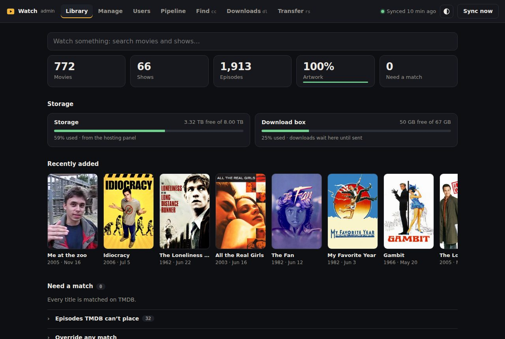
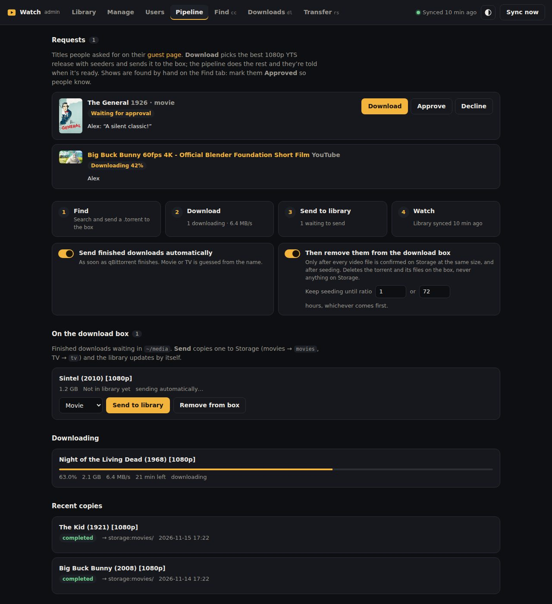
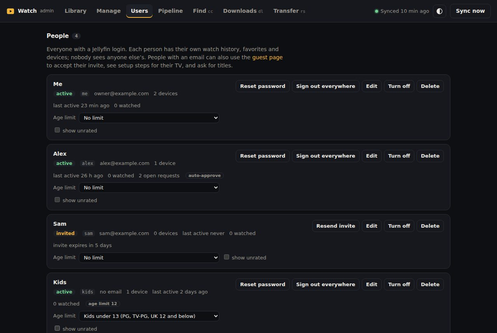
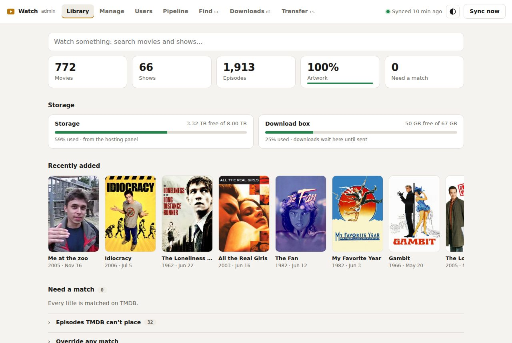
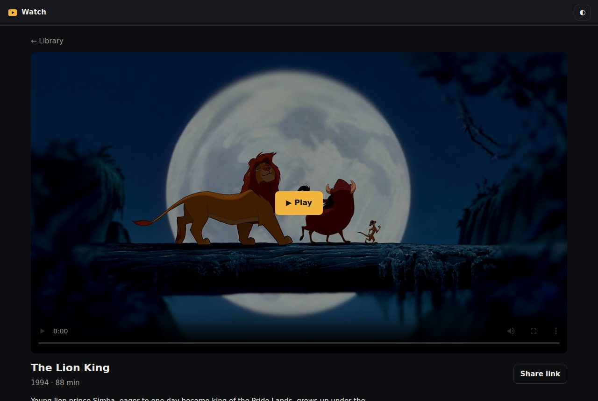
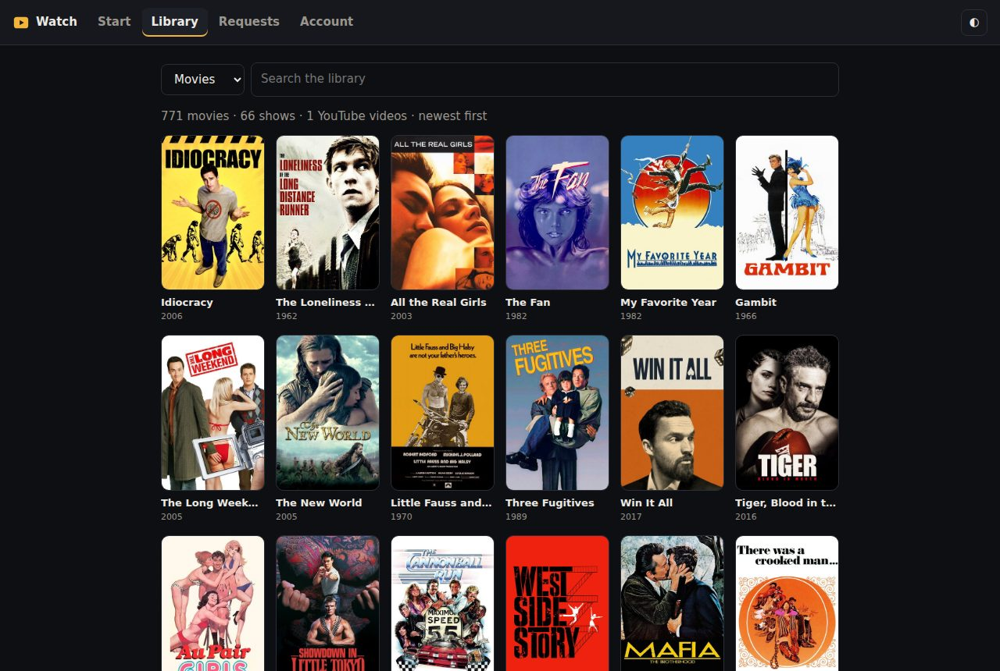
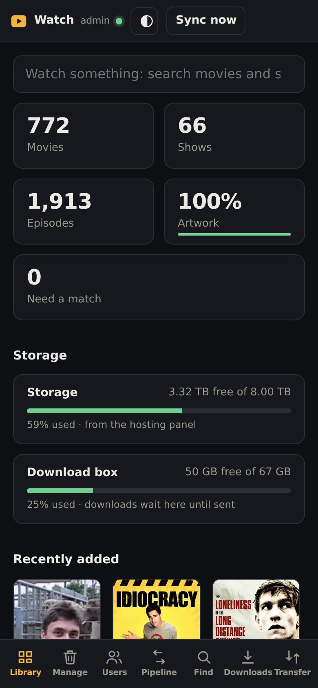
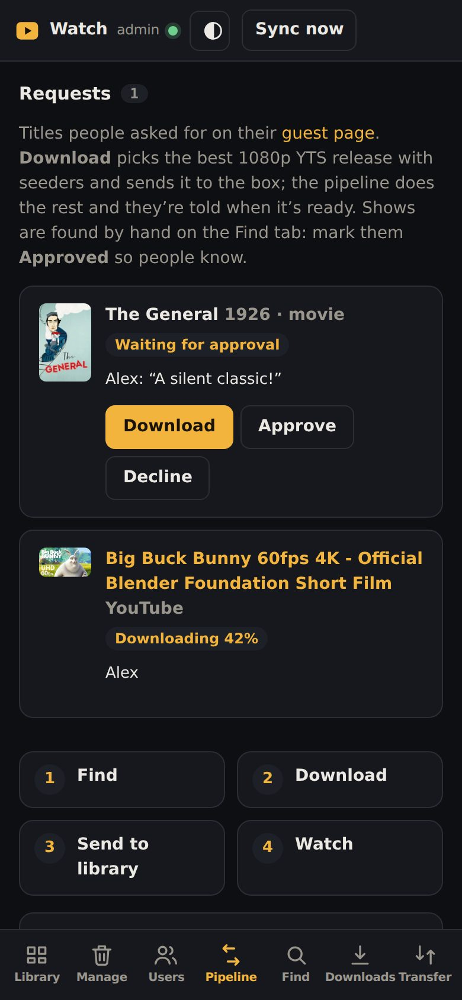

# Screenshots

Taken from a demo install: made-up people and settings, a real library's posters from TMDB.

## Admin page (`/admin`)

**Library**: stats, storage on both machines, recently added, search to watch in the browser.

**Pipeline**: requests from guests (one-click download or approve/decline), downloads on the box, copies to storage,
and YouTube videos and playlists.

**Users**: people and their status, invites by email, age limits, devices.

**Light theme** (automatic, or pick one with the toggle).

## Browser player

Plays directly when the browser can, otherwise converted on the download box while you watch; resume follows you
between the browser and your apps. **Share link** makes a link that plays this one title for anyone.

## Guest page (`/me`)

What invited people see: the library to browse and watch, requests, setup steps for their TV, their devices.

## On a phone

 &nbsp; 

[← Back to the README](../../README.md)
